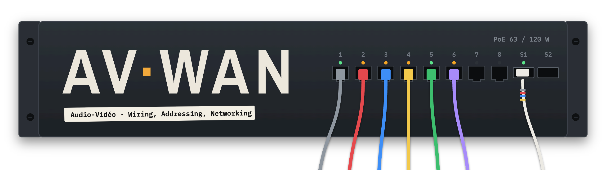
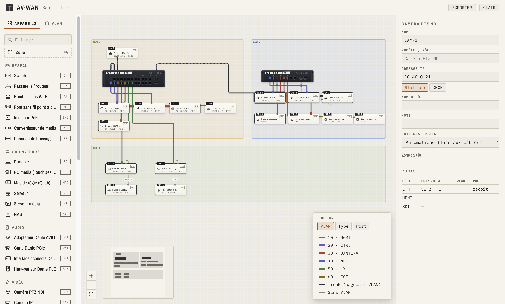
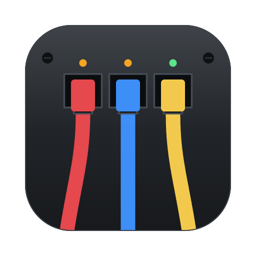

<p align="center">
  <picture>
    <source media="(prefers-color-scheme: dark)" srcset=".github/assets/banniere-sombre.png">
    
  </picture>
</p>

[Français](README.md) | **English**

<p align="center">
  <b>Plan. Patch. Document.</b>
</p>

<p align="center">
  
  
  
  
</p>

## Download

Latest version: the [Releases](https://github.com/sashabedard/AV-WAN/releases/latest) page, with a one-page installation guide (PDF).

- **macOS 13 and later** (Intel and Apple Silicon): `AV-WAN-<version>-universal.dmg`. Drag AV·WAN into Applications. The app is signed and verified by Apple.
- **Windows 10 and 11**: `AV-WAN-<version>-setup.exe`, no administrator rights needed.

> [!WARNING]
> **Windows: on first launch, a blue "Windows protected your PC" window appears.** This is expected, because the installer is not signed. Click **More info**, then **Run anyway**. A Microsoft Store version without this warning is coming soon.

AV·WAN updates itself: the new version downloads in the background, then a banner offers **Restart now**. Use **Help › Check for Updates…** to check right away.

---

## Why AV·WAN

An interactive installation puts very different things on one network: NDI PTZ cameras, a Dante card, pixel controllers, ESP32s, an MQTT broker, a control room. You then have to hand over a reliable **wiring diagram** and **patch list**, and the existing tools make that harder than it should be:

- **Drawing tools** (draw.io, Visio) don't know what a port, a VLAN or PoE is. Every detail is retyped by hand, and the diagram and the table end up contradicting each other.
- **Professional AV tools** that generate these lists cost from US$15 to US$170 a month, or run only on Windows.
- **Network simulators** (Packet Tracer, GNS3) know nothing about Dante, NDI or lighting.

AV·WAN is free, works offline on macOS and Windows, and comes in French and English. Every cable is attached to **a specific port**. The documentation is generated from the diagram, so the two never contradict each other.

## Preview

<p align="center">
  <picture>
    <source media="(prefers-color-scheme: dark)" srcset=".github/assets/capture-sombre.png">
    
  </picture>
</p>

<p align="center"><sub>The example project shipped with the app: control room, hall and stage, two switches linked by fiber, cables colored by VLAN. The app follows the system light or dark theme, or the one chosen at the top right.</sub></p>

## What v1 does

| | |
|---|---|
| **Draw** | Infinite canvas. Drag a device from the palette (97 templates with their icons: switch, AP, NDI PTZ cameras, Dante AVIO, ESP32-POE, PixLite, MQTT broker, patch panel…) or find it with `⌘K`, then drag to move it, snapping to an 8 px grid. |
| **Organize** | Zones (control room, hall, stage) that carry their devices along, `⌘G` to create one around the selection. Copy, paste, duplicate, rename with a double-click. |
| **See** | Cable color by VLAN, by cable type or by port. Click a VLAN in the legend to highlight its devices. Minimap, `⌘0` to fit everything. **Pinned view** (`⇧⌘P`): a frozen thumbnail of a frame of the diagram, live-updated, while the main view stays free; click in it to select, double-click to recenter the main view. |
| **Patch** | DMX address, channels and mode of each device, universe of each node output. The universe is derived from the DMX cable (node › DMX 2 → moving head → moving head) or typed by hand. "Next free" finds the first free range, ⌘D places the copy right after, and overlaps are flagged without ever blocking. Pixel strips occupy their universes starting from the controller output. |
| **Power** | Power draw of each device, 12/24 V power supplies (two values are enough: P = V × I), "DC power" cable, load of each supply with a 20% margin. COB, FCOB, RGBW, pixel LED strips…: W/m × length, amps, pixels and universes. |
| **Configure a switch** | 4, 5, 8, 12, 16, 24 or 48 ports, PoE / PoE+ / PoE++ with a budget in watts, 0 to 4 SFP+ cages. The faceplate is drawn like the real hardware. |
| **My components** | Create your own devices: name, code, category, ports (RJ45, SFP, USB, DMX, HDMI…) with PoE received or supplied, and a custom or imported icon (SVG or PNG). They are reusable from one project to the next, and each project embeds the ones it uses: it opens complete on a machine that doesn't have them. |
| **Lose nothing** | Automatic saving to the file, like an online document (File › Auto Save, on by default); a new project gets its file in Documents › AV·WAN. File › Revert to Opened Version… in case of a mistake. Backup copy every 30 seconds: after an unexpected shutdown, the start screen offers to restore it. Double-click an `.avwan` file to open it. |
| **Connect** | Drag from one port to another, or drop the cable on the device: AV·WAN picks a compatible free port, and a PoE port for a powered device. A port accepts only one cable. Re-plug a cable end by dragging it, and move its elbow. |
| **Set up** | IP of each device (*Static / DHCP* toggle), VLAN as access or trunk, medium (Cat6, OM4 fiber, DAC, Wi-Fi…), length. |
| **Document** | Patch list, per-device sheets, port map of each switch, VLAN sheets with UniFi settings (IGMP Snooping, Querier, ProAV profile…), IP addressing plan, DMX patch, power budget, bill of materials. |
| **Export** | Vector PDF in Tabloid + Letter (or A3 + A4) with a title block on every page, CSV and Excel. |

### Exports

`⌘E` (or the **Export** button at the top) opens the export dialog:

- **Vector PDF**, selectable text, title block and "page x / y" on every page:
  1. diagram in Tabloid (or A3) landscape, with its legend, plus an enlarged page for each zone marked "separate page";
  2. per-device sheets, one line per connection ("ETH › SW-2 · port 1 · PoE+ active (25 W) · VLAN 40 NDI · C-010 Cat6 12 m");
  3. port map of each switch: the faceplate colored by native VLAN, then the port-by-port table;
  4. patch list;
  5. VLAN sheets with the UniFi settings under their exact names;
  6. IP addressing plan, sorted by VLAN then by address;
  7. DMX patch: one table per universe, sorted by address, overlaps noted in the remarks;
  8. power budget: per supply, per zone, total in watts and in amps at the project voltage (120 or 230 V);
  9. bill of materials: devices, cables by length rounded to the meter, SFP+ modules deduced.
- **CSV** for Excel, UTF-8 (separator "," in English, ";" in French): the five lists (patch list, IP plan, DMX patch, power budget, bill of materials), one file each.
- **Excel workbook**: the same five lists, one sheet each, frozen headers and filters on.

The PDF, the CSV and the workbook read the same tables: they never contradict each other.

## Reading an AV·WAN diagram

| What you see | What it means |
|---|---|
| **Cable color** | Its VLAN: Dante in red, NDI in blue, IoT in yellow… |
| **Line style** | The medium: copper as a solid line, fiber with a dashed edge, Wi-Fi dotted, USB/DMX/HDMI dashed with a marker. |
| **Neutral cable with colored rings** | A trunk. Each ring is a tagged VLAN carried on that cable. |
| **Port LED** | Amber: the port powers a device (PoE). Green: link without PoE. Off: free port. |
| **Colored plug seated in a port** | The port is in use. |
| **Lightning bolt ⚡ near one end** | The side supplying PoE power. |
| **Tinted frame with a title** | A zone: control room, hall, stage… |
| **Ribbon label** | The device name (`CAM-PTZ-1`). The boxed code (`CAM`, `DNT`, `IOT`) gives its type. |

## Preset VLANs

They are added in one click. Everything stays editable: numbers, colors, subnets and settings.

| | ID | Name | Subnet | Key UniFi settings |
|---|---|---|---|---|
|  | 10 | Management | 10.10.10.0/24 | Network Isolation |
|  | 20 | Control / OSC | 10.20.0.0/24 | IGMP Snooping, Querier, mDNS |
|  | 30 | Dante A | 10.30.0.0/24 | IGMP, Querier, Fast Leave, Flood Known Protocols, ProAV profile "Dante Audio" |
|  | 31 | Dante B | 172.31.0.0/16 | Same as Dante A, no DHCP, never routed |
|  | 40 | NDI | 10.40.0.0/23 | IGMP, Querier, jumbo frames off |
|  | 50 | Lighting | 10.50.0.0/24 | sACN / Art-Net isolated |
|  | 60 | IoT / MQTT | 10.60.0.0/24 | Network Isolation, Wi-Fi 2.4 GHz |
|  | 70 | Cameras | 10.70.0.0/24 | Network Isolation |
|  | 80 | Media | 10.80.0.0/24 | Jumbo frames possible |
|  | 99 | Guests | 10.99.0.0/24 | Isolation, Internet access |

Why separate Dante, NDI and lighting? Their multicast streams all fall in the `239.255.x.x` range. On the same VLAN, they step on each other.

## Getting started (development)

Node.js 24 or newer is required (tested with Node 26), and npm 11.

```bash
npm install          # also installs the Electron binary (postinstall)
npm run dev          # runs the app with hot reload
npm test             # unit and component tests (Vitest)
npm run typecheck    # strict TypeScript
npm run e2e          # build, then end-to-end tests (Playwright + Electron)
npm run peek         # app screenshot, window never visible (test-results/peek.png)
npm run captures     # regenerates the README screenshots from the example project
npm run rendu:maj    # updates the reference canvas screenshots (e2e/rendu.spec.ts-snapshots)
npm run brand        # regenerates the app icon and logos from build/icon.svg (macOS)
npm run dist:dir     # unnotarized universal app in release/mac-universal (nothing is launched)
npm run guide        # PDF installation guides (French and English) in release/
npm run build        # production build in out/
```

## Publishing a release

1. Once, add the repository secrets (Settings › Secrets and variables › Actions):
   - `MAC_CERT_P12_BASE64`: the "Developer ID Application" certificate exported as `.p12`, base64-encoded (`base64 -i certificat.p12 | pbcopy`);
   - `MAC_CERT_PASSWORD`: the `.p12` password;
   - `APPLE_ID`: the Apple ID of the developer account;
   - `APPLE_APP_SPECIFIC_PASSWORD`: an app-specific password created at appleid.apple.com (Sign-In and Security › App-Specific Passwords).
2. `npm version 1.0.0` for the first public version, then `npm version minor` (or `patch`) for the following ones; then `git push --follow-tags`.
3. CI builds the notarized DMG and the Windows installer, checks the `.avwan` association, and creates a **draft** release with the PDF guides.
4. Test the files in the draft, then **Publish**. Installed apps then offer the update.
5. Microsoft Store: download the run's `microsoft-store` artifact (`AV-WAN-<version>-store.appx`, unsigned) and upload it to a new submission in Partner Center. The Store signs and distributes it after certification.

## Architecture

```
src/main/        Electron process: .avwan files (atomic write), native menu, IPC,
                 PDF export (hidden print window), CSV and Excel
src/preload/     secure bridge (sandbox, contextIsolation)
src/shared/      shared types: IPC API, data tables, PDF options
src/renderer/    the React interface
  model/         the project: zod schema, connection rules, derived VLANs and PoE
  catalog/       device templates, switch configurator, preset VLANs
  reports/       pure reports: patch list, sheets, ports, VLANs, IP, bill of materials
  export/        PDF print view and export dialog
  store/         project state, undo history, selection
  canvas/        React Flow: switch faceplate, tiles, cables
  panels/        palette, inspector
```

**A single source of truth.** The project is a validated JSON file. The canvas, the inspector and the PDF are only *views* of it, which keeps them from contradicting each other. `model/`, `catalog/` and `reports/` depend on neither the interface nor Electron, and are tested in a few milliseconds.

## The name



**AV·WAN** is pronounced "Avi-Wan". Yes, it sounds like what you think it does.

It stands for **A**udio-**V**ideo · **W**iring, **A**ddressing, **N**etworking. Each letter of WAN maps to a part of the app: the cables, the IP addresses and the VLANs.

## Credits

- Canvas: [React Flow](https://reactflow.dev) (MIT).
- Typography: [Archivo Narrow](https://fonts.google.com/specimen/Archivo+Narrow) and [IBM Plex Mono](https://github.com/IBM/plex) (SIL Open Font License), bundled in the app to work offline.
- Built with Electron, React, zustand, zod and Vitest.
- Domain data: public documentation from Audinate (Dante), NDI, Ubiquiti (UniFi), ESTA (sACN) and manufacturers.

## License

© 2026 Sasha Bédard. All rights reserved. See [LICENSE](LICENSE).

- **The application** is free for any use, including professional, downloaded from the [Releases](https://github.com/sashabedard/AV-WAN/releases) page.
- **The source code** is published for viewing only: copying, modifying or redistributing it requires written permission.
- **Attribution required** for any presentation or publication: "AV·WAN — © 2026 Sasha Bédard — https://github.com/sashabedard/AV-WAN".
- **Privacy**: AV·WAN collects no data. See [PRIVACY.md](PRIVACY.md).
